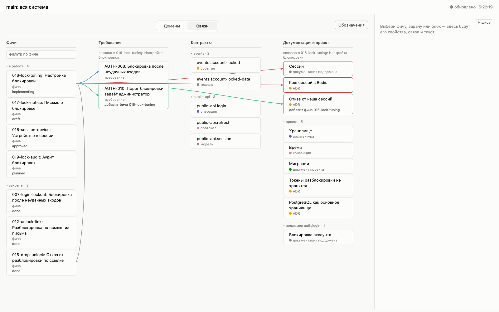
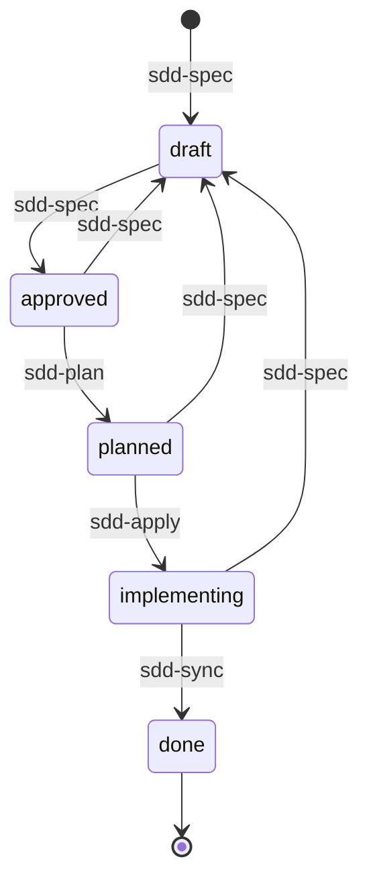
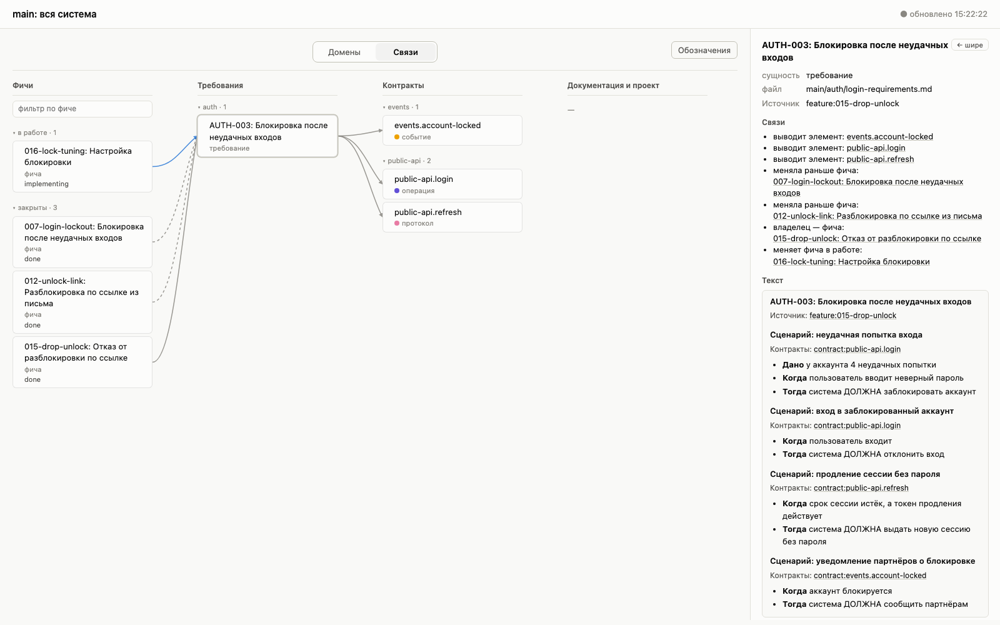
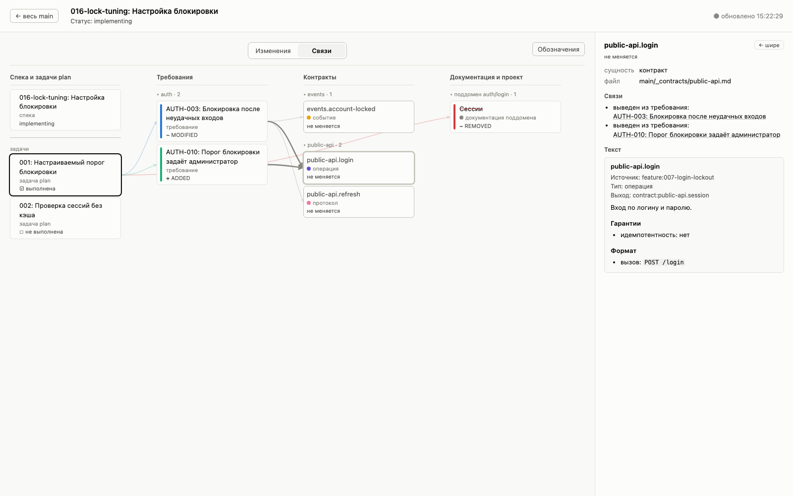
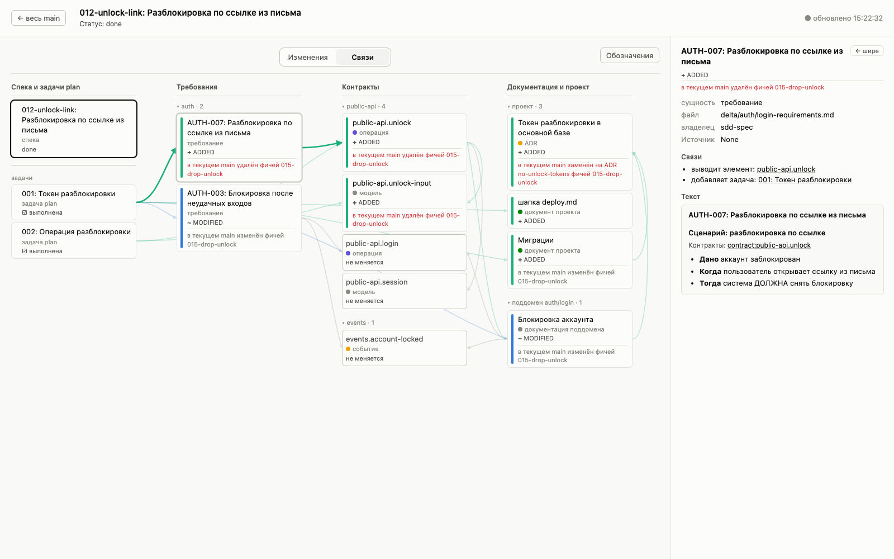
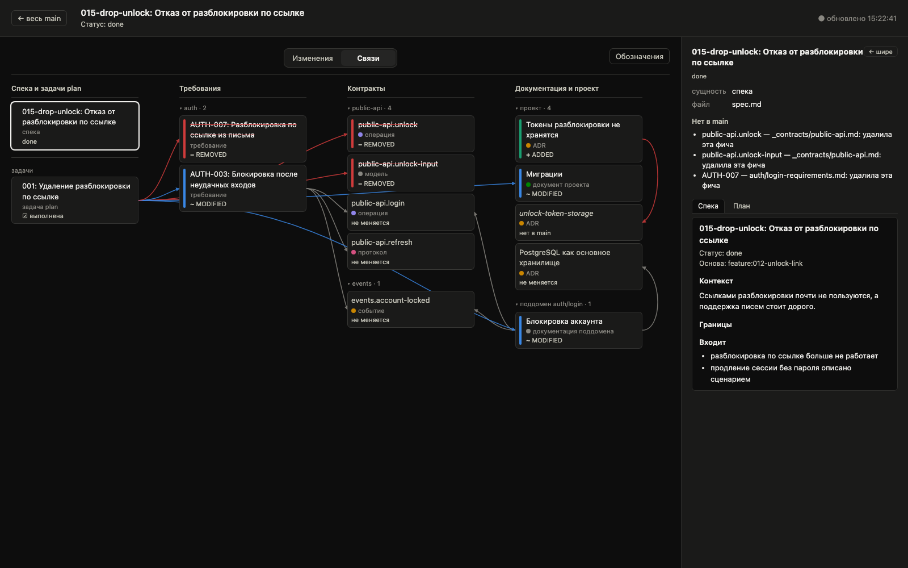

# lightspec

Spec-Driven Development для AI-агентов: скилы Claude Code, форматы спецификаций и движок, который проверяет их и вливает изменения.

Фича проходит путь «спека → план → код → main». На каждом шаге агент пишет файлы по строгим форматам, а движок проверяет форму, ссылки и связи. Человек подтверждает переходы и смотрит, что меняется, на интерактивном графе.



## Зачем

- **Знание о системе живёт в `specs/main/`**, а не в головах и чатах: требования, контракты API, документация поддоменов, архитектура и ADR.
- **Каждое изменение — фича** со спекой, планом и `delta/`: точными частями main, которые она добавляет, меняет или удаляет.
- **Агент пишет, движок проверяет.** Форма файлов, ссылки, связи требований с контрактами и документацией, конфликты с main — всё это проверяет программа, а не агент на глаз.
- **Переходы — с апрувом человека.** Агент показывает итог и ждёт явного «да».

## Как работает

Четыре скила ведут фичу по статусам спеки:



| Скил | Что делает | Результат |
|---|---|---|
| `sdd-spec` | собирает требования вопросами, пишет спеку и `delta/` требований и контрактов | `spec.md` в `approved` |
| `sdd-plan` | пишет план с задачами, `delta/` документации и ADR | `plan.md`, `spec` в `planned` |
| `sdd-apply` | выполняет задачи плана в коде и тестах | задачи отмечены, `spec` в `implementing` |
| `sdd-sync` | вливает `delta/` в main, переносит ADR, закрывает фичу | `spec` в `done`, фича в `archive/` |

Перед каждым переходом скил запускает проверку движка. Она проходит — агент показывает итог и ждёт апрув.

### Что лежит в `specs/`

```
specs/
  main/                         текущее состояние системы
    auth/
      login-requirements.md     требования поддомена: сценарии «Дано / Когда / Тогда»
      login.md                  документация: как устроено и почему
    _contracts/
      public-api.md             контракт для внешних клиентов: операции, события, модели
    _project/
      architecture.md           устройство системы
      conventions.md            конвенции кода
      deploy.md                 другие темы проекта
      adr/postgres.md           действующие архитектурные решения
  new/
    012-unlock-link/            фича в работе
      spec.md                   что меняется и зачем, языком бизнеса
      plan.md                   задачи: что, как, файлы кода, что реализуют
      delta/                    части main, которые фича добавит, изменит или удалит
  archive/                      закрытые фичи
```

## Установка

Нужны Claude Code и Python 3.9 или новее. Зависимостей нет.

```sh
git clone https://github.com/nordrocks/lightspec.git
mkdir -p ~/.claude/skills
cp -R lightspec/skills/* ~/.claude/skills/
```

Скилы ищут правила, форматы и движок рядом с собой, поэтому содержимое `skills/` копируется целиком, в одну папку: `sdd-*`, `rules.md`, `syntax.md`, `formats/`, `engine/`. Если у вас в `~/.claude/skills/` уже есть файлы `rules.md` или `syntax.md`, они будут перезаписаны.

Для одного проекта вместо `~/.claude/skills/` используйте `<проект>/.claude/skills/`.

## Использование

В Claude Code, в корне проекта:

```
/sdd-spec Заблокированный пользователь не может войти и пишет в поддержку
/sdd-plan 012
/sdd-apply 012
/sdd-sync 012
```

Папка `specs/` создаётся в корне проекта. Фичу можно указать номером, `<ID фичи>` или путём к `spec.md`.

Когда агент начинает работу над фичей, он открывает граф этой фичи в браузере. Если граф проекта уже открыт, он переключается на фичу сам.

## Движок

`skills/engine/` — один пакет без зависимостей. Агент его запускает, но не читает:

```sh
python3 ~/.claude/skills/engine <команда> <аргументы>
```

| Команда | Для чего |
|---|---|
| `next feature`, `next req <домен>` | номер новой фичи, ID нового требования |
| `check-spec <фича>` | проверки перехода `draft` → `approved` |
| `check-plan <фича>` | проверки `approved` → `planned` и проверка до вливания |
| `sync <фича>` | проверки и вливание `delta/` в main |
| `graph [<фича>]` | граф в браузере |
| `examples` | примеры из `formats/` проходят свои форматы — для тех, кто меняет фреймворк |

Что проверяет движок:
- **синтаксис** — по LL(1)-грамматике из `syntax.md`: заголовки, свойства, fence, ошибки с номером строки
- **схему** сущности — по таблице «Структура» её формата: порядок и обязательность частей и свойств, типы значений, ID в заголовке совпадает с путём
- **ссылки** `req:`, `contract:`, `adr:`, `feature:`, `doc:` ведут на существующие узлы. Из контрактов — только `contract:`
- **связи:** каждая операция видна в сценарии, модели используются, изменённый элемент контракта тянет правку документации
- **план:** задачи реализуют все части `delta/` требований и контрактов и документируют все файлы документации
- **конфликты** с main: часть за это время не изменила другая фича

Нарушения, которые внесла фича, блокируют переход. То, что уже было в main без неё, выводится предупреждениями.

## Граф

Граф показывает систему и фичи: что от чего зависит, кто что менял, что изменит фича.

```sh
python3 skills/engine graph --specs examples/specs --open
```

**Общий режим** — весь main и все фичи. Наведение показывает связи, нажатие на блок оставляет только связанное с ним. У фичи в работе видно, что она добавит, изменит и удалит. У закрытой — чьи версии блоков сейчас в main и что уже удалено.



**Режим фичи** — её спека, задачи и части `delta/`. Нажатие на спеку рисует все изменения, на задачу — путь её изменений.




У закрытой фичи части в цветах её delta, а нижняя строка карточки говорит, что с частью в текущем main:



Светлая и тёмная тема — по настройке системы:



Подробно — в [`skills/engine/GRAPH.md`](skills/engine/GRAPH.md).

## Пример

`examples/specs/` — небольшой проект «вход и блокировка аккаунта» с историей:
- `007` → `012` → `015` закрыты
- `016`–`019` — по фиче в каждом статусе от `draft` до `implementing`

Пример собран настоящими командами `check-plan` и `sync`. Его удобно смотреть в графе:

```sh
python3 skills/engine graph --specs examples/specs --open
python3 skills/engine graph 016 --specs examples/specs --open
```

## Документация

| Файл | О чём |
|---|---|
| [`skills/rules.md`](skills/rules.md) | система: сущности, владельцы знаний, связи, доступ скилов, статусы и переходы, команды |
| [`skills/syntax.md`](skills/syntax.md) | как записан любой файл `specs/`: разметка, идентификаторы, ссылки, свойства, схема сущности |
| [`skills/formats/`](skills/formats) | форматы сущностей: spec, plan, delta, требования, контракты, документация, проект, ADR |
| [`skills/sdd-*/SKILL.md`](skills) | шаги каждого скила |
| [`skills/engine/README.md`](skills/engine/README.md) | как движок разбирает файлы: пути, лексика, грамматика, ошибки, модули |
| [`skills/engine/GRAPH.md`](skills/engine/GRAPH.md) | граф: режимы, цвета, связи, взаимодействие, JSON |
