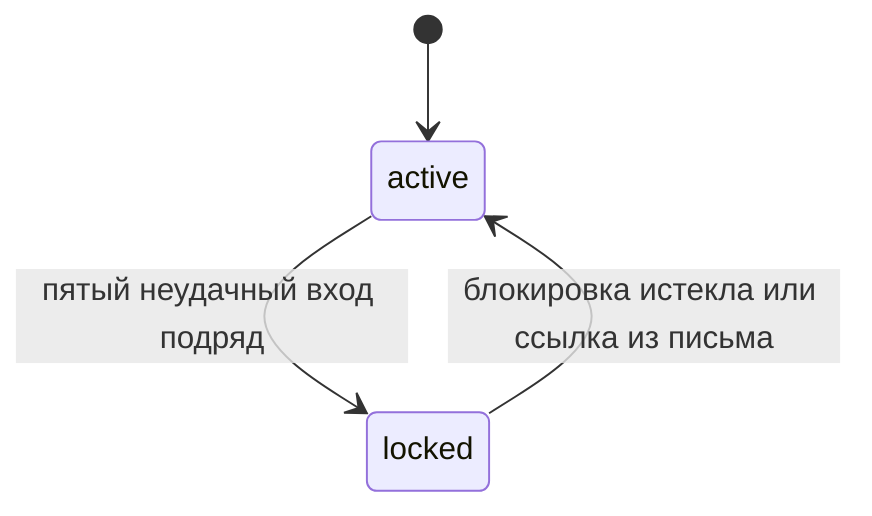
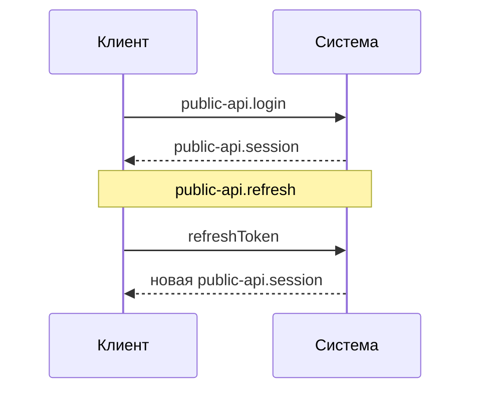

## Блокировка аккаунта
Изменение: ADDED
Источник: None
Причина: None
Контракты: contract:public-api.login, contract:events.account-locked

### Как работает

Счётчик неудачных попыток хранится по аккаунту и меняется вместе с проверкой пароля. При блокировке публикуется contract:events.account-locked.

### Почему так

- счётчик в базе, а не в кэше: блокировка должна переживать перезапуск, adr:postgres

### Ограничения

- при сотнях попыток в секунду на один аккаунт счётчик становится узким местом

## Сессии
Изменение: ADDED
Источник: None
Причина: None
Контракты: contract:public-api.session, contract:public-api.refresh

### Как работает

| Токен | Для чего | Как проверяется |
|---|---|---|
| `token` | вызовы с доступом «пользователь» | по подписи, без обращения к хранилищу |
| `refreshToken` | продление сессии | по записи в хранилище, поэтому его можно отозвать |
