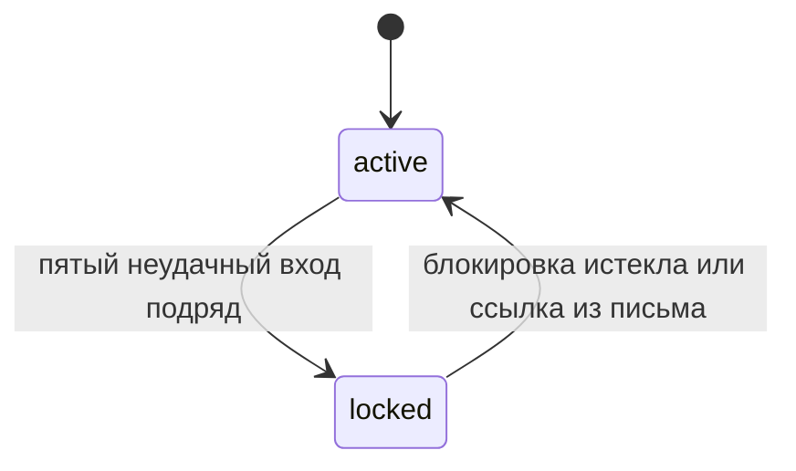

## Блокировка аккаунта
Изменение: MODIFIED
Источник: feature:007-login-lockout
Причина: None
Контракты: contract:public-api.login, contract:events.account-locked, contract:public-api.unlock

### Как работает

Счётчик и токен разблокировки contract:public-api.unlock. Токен хранится в базе: adr:unlock-token-storage.
