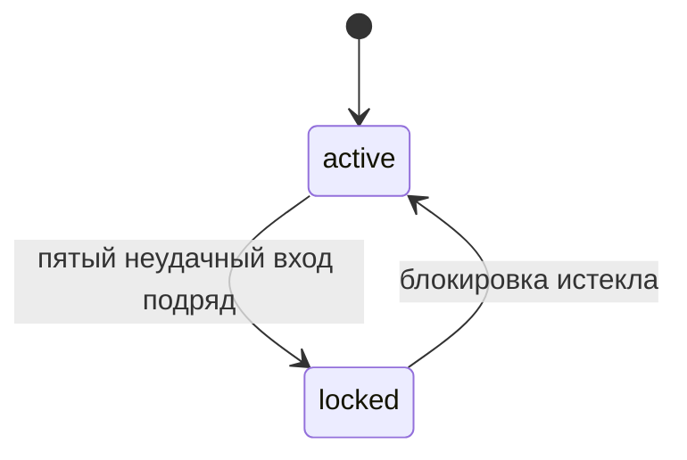

## Блокировка аккаунта
Изменение: MODIFIED
Источник: feature:012-unlock-link
Причина: None
Контракты: contract:public-api.login, contract:events.account-locked

### Как работает

Счётчик неудачных попыток хранится по аккаунту: adr:postgres.
