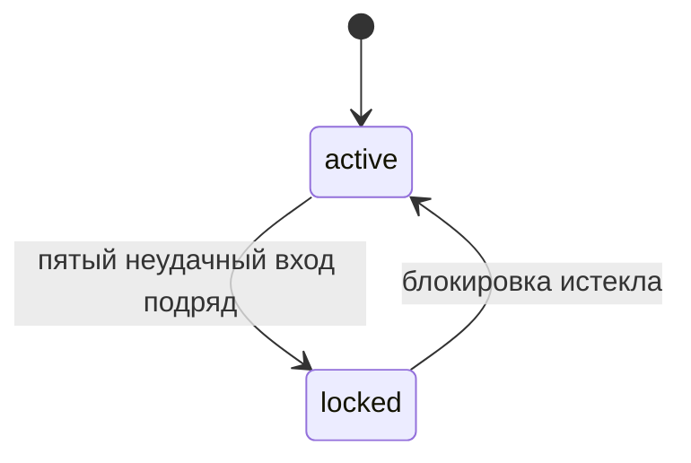
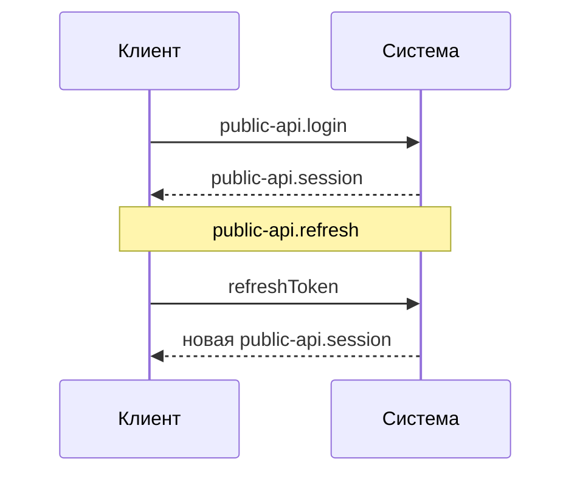

# Вход: документация
Источник: feature:007-login-lockout

Вход по паролю, блокировка аккаунта и сессии.

## Блокировка аккаунта
Источник: feature:015-drop-unlock
Контракты: contract:public-api.login, contract:events.account-locked

### Как работает

Счётчик неудачных попыток хранится по аккаунту: adr:postgres.

## Сессии
Источник: feature:007-login-lockout
Контракты: contract:public-api.session, contract:public-api.refresh

### Как работает

| Токен | Для чего | Как проверяется |
|---|---|---|
| `token` | вызовы с доступом «пользователь» | по подписи, без обращения к хранилищу |
| `refreshToken` | продление сессии | по записи в хранилище, поэтому его можно отозвать |
