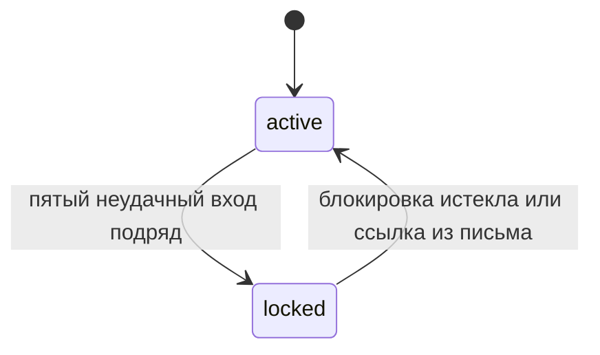
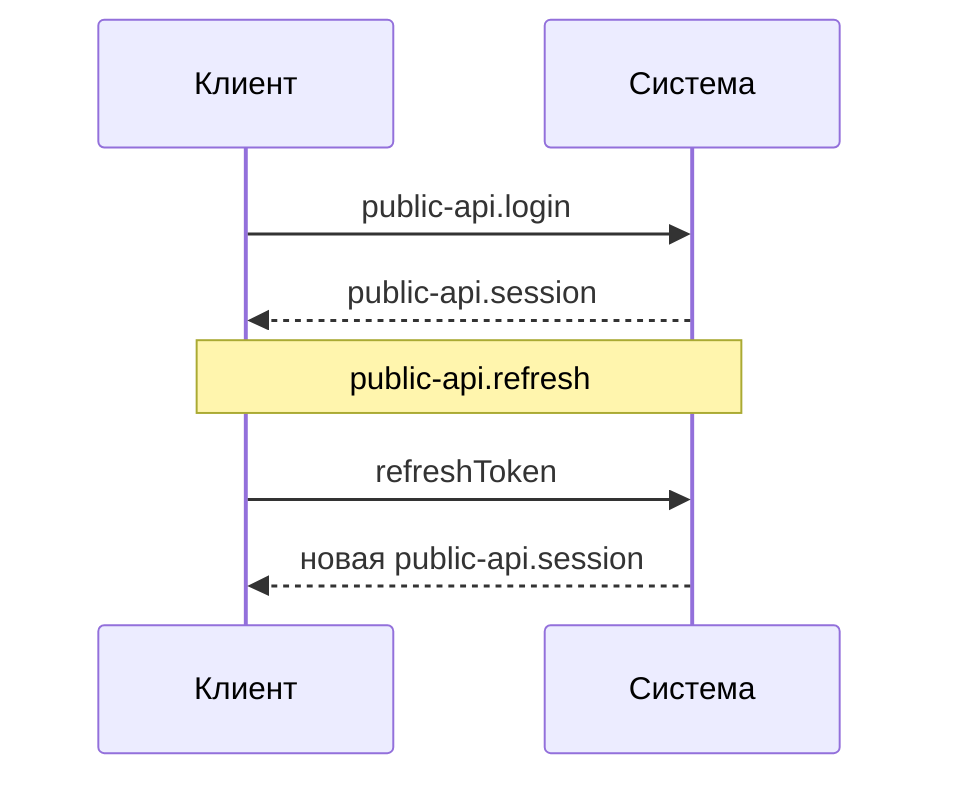

# Формат документации поддомена

Формат `domain-docs`: устройство поддомена — механизмы, состояния и потоки данных — и обоснование решений.

## Структура

| Что | Заголовок | Свойство | Обязательно | Содержание |
|---|---|---|---|---|
| шапка | `# <название поддомена>: документация` | — | да | 1–2 строки: что описано и как блоки связаны между собой |
| шапка | | `Источник:` | да | — |
| блок | `## <название>` | — | да | только разделы — по «Блоку» |
| блок | | `Источник:` | да | — |
| блок | | `Контракты:` | нет | элементы контрактов, с которыми связан блок |
| как работает | `### Как работает` | — | да | механизм, состояния, потоки данных |
| почему так | `### Почему так` | — | нет | чем решения важны для поддомена. Решение из ADR — со ссылкой `adr:<ID ADR>` |
| ограничения | `### Ограничения` | — | нет | компромиссы и узкие места |

## Пример

````markdown
# Вход: документация
Источник: feature:007-login-lockout

Вход по паролю, блокировка аккаунта и сессии.

## Блокировка аккаунта
Источник: feature:012-unlock-link
Контракты: contract:public-api.login, contract:events.account-locked

### Как работает



Счётчик неудачных попыток хранится по аккаунту и меняется вместе с проверкой пароля. При блокировке публикуется contract:events.account-locked.

### Почему так

- счётчик в базе, а не в кэше: блокировка должна переживать перезапуск, adr:postgres

### Ограничения

- при сотнях попыток в секунду на один аккаунт счётчик становится узким местом

## Сессии
Источник: feature:007-login-lockout
Контракты: contract:public-api.session, contract:public-api.refresh

### Как работает



| Токен | Для чего | Как проверяется |
|---|---|---|
| `token` | вызовы с доступом «пользователь» | по подписи, без обращения к хранилищу |
| `refreshToken` | продление сессии | по записи в хранилище, поэтому его можно отозвать |
````

## Блок

- один механизм или поток внутри поддомена, а не отдельное требование
- описывает текущее состояние: без истории и номеров фич, кроме `Источник:`

## Диаграммы

- подписи — понятия бизнеса и имена элементов контракта, а не ID требований
- участники и узлы — понятия бизнеса, а не имена из `code`
