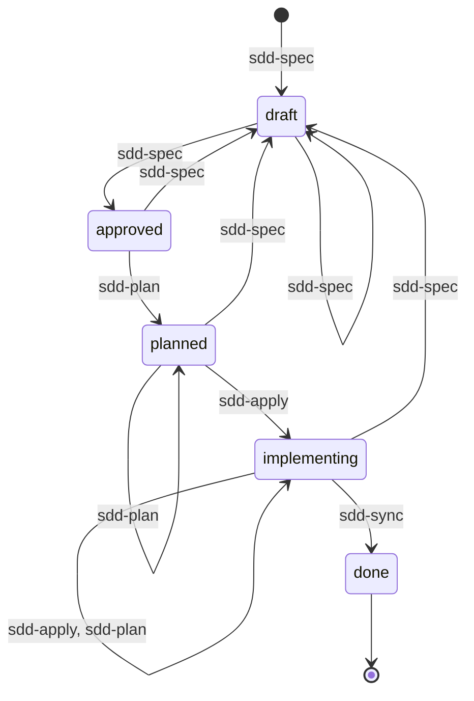

# Правила SDD-скилов

Обязательны для `sdd-spec`, `sdd-plan`, `sdd-apply`, `sdd-sync`.
При расхождении со SKILL.md следуй этому файлу.

## Где что описано

Каждое правило — в одном месте. В других местах на него ссылаются, не пересказывают.

| Файл | Отвечает на вопрос | Содержит | Не содержит |
|---|---|---|---|
| `rules.md` | что есть в системе и как она живёт | сущности: якорь, путь, зона знания. Связи между сущностями. Доступ скилов. Статусы и переходы. Команды и их вывод. Процесс Открытых вопросов | как записан файл, схему сущности, шаги скила |
| `syntax.md` | как записан любой файл `specs/` | разметку: шапка, блок, раздел, свойство, тело, fence. Идентификаторы. Запись и поиск ссылок. Типы свойств и реестр. Как читать «Структуру». Оформление тела | где лежат файлы, куда должна вести ссылка, смысл сущностей, как скрипты разбирают файл |
| `engine/README.md` | как скрипты разбирают файл | пути → стартовый символ, лексику, грамматику, ошибки разбора | правила записи файлов: агенту его читать не нужно |
| `formats/<формат>.md` | как устроен файл одной сущности | что относится к сущности и что нет. «Структура», пример, правила содержания частей | путь, общий синтаксис, кто и когда пишет |
| `<скил>/SKILL.md` | что делает скил | запуск, шаги по порядку, что читать сверх общего правила, «Итог» | правила, верные вне скила: вместо них — ссылка |

Куда класть правило — первый вопрос с ответом «да»:
1. Говорит о нескольких сущностях, о месте файла, о владении, доступе, статусах или командах? — `rules.md`
2. Верно для любого файла `specs/` и говорит, как его записать? — `syntax.md`
3. Говорит о частях, свойствах или содержании одной сущности? — её формат
4. Это действие скила в его последовательности? — `SKILL.md`, правило — ссылкой

## Порядок работы

1. Запуск без аргумента — найди `spec` в статусах из «Запуска» скила. Одна — предложи её, несколько — спроси.
2. Перед любым действием проверь:
   - на диаграмме «Статусов спеки» у твоего скила есть переход из текущего статуса
   - файл и изменение разрешены в «Доступе к сущностям»
3. Проверка не прошла — не делай действие. Объясни пользователю причину и назови скил, который нужен дальше: владельца сущности в «Доступе к сущностям» или скил перехода на диаграмме «Статусов спеки».
4. В конце работы выведи в чат «Итог» скила, статус спеки и следующий шаг. «Итог» в файлы не пиши.

## Структура specs

`specs/` лежит в корне проекта: корень git-репозитория, без git — рабочая директория.

`main/` — текущее состояние системы. Это не git-ветка `main`.

```
specs/
  new/
    012-unlock-link/
      spec.md
      plan.md
      delta/
        auth/
          login-requirements.md
          login.md
        _contracts/
          public-api.md
        _project/
          adr/
            unlock-token-storage.md
  archive/
    007-login-lockout/
      ...
  main/
    _project/
      architecture.md
      conventions.md
      deploy.md
      adr/
        postgres.md
    _contracts/
      common.md
      public-api.md
      events.md
    auth/
      login.md
      login-requirements.md
      sessions.md
      sessions-requirements.md
    common/
      access.md
      access-requirements.md
    payments/
      checkout.md
      checkout-requirements.md
```

### Сущности

Якорь — имя сущности в правилах и форматах. Пути — от `specs/`.
Синтаксис всех файлов — [syntax.md](syntax.md). Прочитай его и формат сущности, когда пишешь, меняешь или проверяешь её файл. Файл в `delta/` — ещё и `formats/delta.md`.

| Якорь | Сущность | Где | Формат |
|---|---|---|---|
| `feature` | фича | `new/<ID фичи>/`, после `done` — `archive/<ID фичи>/` | — |
| `spec` | спека | `spec.md` в `feature` | [formats/spec.md](formats/spec.md) |
| `plan` | план | `plan.md` в `feature` | [formats/plan.md](formats/plan.md) |
| `delta` | дельта | `delta/` в `feature`, пути — как в `main/` | [formats/delta.md](formats/delta.md) |
| `domain` | домен | `main/<домен>/` | — |
| `subdomain` | поддомен | пара файлов в `domain`: `requirements` и `domain-docs` | — |
| `requirements` | требования | `main/<домен>/<поддомен>-requirements.md` | [formats/requirements.md](formats/requirements.md) |
| `domain-docs` | документация | `main/<домен>/<поддомен>.md` | [formats/domain-docs.md](formats/domain-docs.md) |
| `contracts` | контракты | `main/_contracts/<интерфейс>.md` | [formats/contracts.md](formats/contracts.md) |
| `project` | общая область | `main/_project/` | — |
| `architecture` | архитектура | `main/_project/architecture.md` | [formats/project.md](formats/project.md) |
| `conventions` | конвенции | `main/_project/conventions.md` | [formats/project.md](formats/project.md) |
| `project-doc` | документ проекта | `main/_project/<тема>.md`, кроме `architecture.md` и `conventions.md` | [formats/project.md](formats/project.md) |
| `adr` | архитектурное решение | в `feature` — `delta/_project/adr/`, в main — `main/_project/adr/`, только действующие | [formats/adr.md](formats/adr.md) |
| `code` | код | вне `specs/` | — |

- `<поддомен>` не кончается на `-requirements`: файл `<поддомен>-requirements.md` — всегда `requirements`
- другие `.md` в `main/` и `delta/` — ошибка
- новый `project-doc` — только после «да» пользователя
- номер в `<ID фичи>` — от `next feature` по «Командам». Идентификаторы — по «Идентификаторам» в `syntax.md`

### Узлы ссылок

Где определён узел, на который ведёт ссылка, — по «Видам ссылок» в `syntax.md`:

| Вид | Узел | Где определён |
|---|---|---|
| `feature:` | фича | папка `new/<ID фичи>/` или `archive/<ID фичи>/` |
| `req:` | требование | блок `## <ID требования>: <название>` в `requirements` |
| `contract:` | элемент контракта | блок `## <ID элемента>` в `contracts` |
| `adr:` | действующий ADR | файл `<ID ADR>.md` в `main/_project/adr/` или в `delta/_project/adr/` фичи |
| `doc:` | документация | файл `<ID документа>.md` `domain-docs`, `architecture`, `conventions` или `project-doc` в `main/` или в `delta/` фичи |

### Владельцы знаний

Знание пишут только у его владельца. В другой сущности на него ссылаются: `вид:id`, без пересказа. Расходятся — прав владелец.

| Якорь | Знание |
|---|---|
| `feature` | контейнер фичи: `spec`, `plan`, `delta`. Своего знания нет |
| `spec` | что меняет фича и зачем, языком бизнеса |
| `plan` | как реализовать фичу: задачи и файлы `code` |
| `delta` | контейнер изменений main: файлы в формате своих сущностей. Своего знания нет |
| `domain` | область бизнеса со своими понятиями. Выделяется по смыслу для бизнеса, не по устройству кода. `common/` — общее для всех доменов |
| `subdomain` | группа связанных правил внутри `domain` |
| `requirements` | бизнес-правила `subdomain`: что и когда система делает для пользователя |
| `domain-docs` | как устроен `subdomain` и почему так |
| `contracts` | что система даёт внешним клиентам. Выводится из `requirements` |
| `project` | контейнер: `architecture`, `conventions`, `project-doc`, `adr`. Своего знания нет, `requirements` нет |
| `architecture` | устройство системы |
| `conventions` | конвенции кода |
| `project-doc` | одна тема, общая для всей системы, которой нет в `architecture` и `conventions`: сборка, деплой, окружения |
| `adr` | архитектурно значимое решение и его обоснование |
| `code` | реализация: код, тесты, конфигурация |

### Не документируется

Ни одна сущность этого не хранит:

| Что | Почему |
|---|---|
| раскладка и визуальный стиль интерфейса | `requirements` описывают, что видит пользователь, а не как это выглядит |
| пути к `code` вне `plan` | устаревают, нужный код агент находит поиском |

### Обязательные связи

Команды проверяют их на main с наложенной `delta`:

| Связь | Правило |
|---|---|
| ссылка → узел | ссылка в свойстве или тексте ведёт на существующий узел, кроме `Источник:`. Из `contracts` — только `contract:`: клиенты получают только `_contracts/` |
| сценарий → элемент контракта | на каждую операцию, событие и протокол ссылается хотя бы один сценарий в `Контракты:` |
| элемент → модель | на каждую модель ссылается другой элемент |
| `delta` → сценарий | фича добавила или изменила операцию, событие или протокол — в её `delta` есть сценарий с ним в `Контракты:` |
| `delta` → документация по контракту | фича изменила или удалила элемент контракта — в её `delta` есть MODIFIED или REMOVED каждого блока `domain-docs` с этим элементом в `Контракты:` |
| `delta` → документация поддомена | фича изменила требования поддомена, а его `domain-docs` в `delta` нет — предупреждение. Нужна ли правка документации, агент решает с пользователем |

## Доступ к сущностям

Что не разрешено в таблице — запрещено. main меняет только `sdd-sync`.

| Сущность | sdd-spec | sdd-plan | sdd-apply | sdd-sync |
|---|---|---|---|---|
| `feature` | создаёт | — | — | переносит в `archive/` после `done` |
| `spec` | владелец | R; `Статус: planned` | R; `Статус: implementing` | R; `Статус: done` |
| `plan` | — | владелец | R; отметки задач, Открытые вопросы | R |
| `delta-requirements`, `delta-contracts` | владелец | R | R | R |
| `delta-domain-docs`, `delta-architecture`, `delta-conventions`, `delta-project-doc`, `delta-adr` | R | владелец | R | R |
| `code` | R | R | владелец | — |
| `requirements`, `contracts`, `domain-docs`, `architecture`, `conventions`, `project-doc`, `adr` | R | R | R | владелец |

`delta-<якорь>` — файлы сущности в `delta/` фичи. Без префикса — в main.

Значения:
- **владелец** — создаёт и меняет содержимое
- **R** — только читает
- **R; …** — читает и меняет только перечисленное
- **—** — не трогает

## Статусы спеки



### Условия переходов

Переход — только когда пройдены все его проверки. Проверяют трое:
- **команда** — запусти её по «Командам». Нарушения исправь и запусти снова
- **агент** — проверь сам, до апрува
- **пользователь** — апрув: явное «да» после «Итога» в чате

| Переход | Когда | Команда | Агент | Апрув |
|---|---|---|---|---|
| → `draft` | новая фича или изменение фичи в `done` | — | — | — |
| `draft` → `approved` | `spec` готова | `check-spec` | да | да |
| `approved`, `planned`, `implementing` → `draft` | нужно изменить `spec` | — | — | — |
| `approved` → `planned` | `plan` готов | `check-plan` | — | да |
| `planned` → `implementing` | начало реализации | — | — | — |
| `implementing` → `done` | все задачи выполнены | `sync` | — | — |

**→ `draft`**
- действия:
  1. создай `feature` и `spec.md` со `Статус: draft`
  2. изменение фичи в `done` — новая `spec` с `Основа:` на неё

**`draft` → `approved`**
- `check-spec` проверяет:
  1. нет Открытых вопросов в `spec`
  2. форма `spec` и `delta/` верна
  3. ссылки и «Обязательные связи» сценариев и элементов контракта верны на main с `delta`
- агент проверяет:
  1. `delta` покрывает «Входит», пунктов «Не входит» в ней нет
  2. Контекст — языком бизнеса, без кода

**`approved`, `planned`, `implementing` → `draft`**
- действия:
  1. запиши в Решения, что меняется и почему
  2. код и отметки задач не откатывай

**`approved` → `planned`**
- `check-plan` проверяет:
  1. всё, что проверяет `check-spec`
  2. `Реализует:` и `Документация:` задач — по «Задаче» в `formats/plan.md`
  3. нет Открытых вопросов в `plan`
  4. форма `plan` и ADR фичи верна
  5. нет конфликтов с main
  6. ссылки и «Обязательные связи» документации верны на main с `delta`

**`implementing` → `done`**
- `sync` проверяет:
  1. всё, что проверяет `check-plan`
  2. все задачи `plan` отмечены
- `sync` выполняет, если проверки прошли:
  1. вливает `delta/` в main
  2. переносит `adr` фичи в main, удаляет заменённые
  3. ставит `Статус: done`
  4. переносит `feature` в `archive/`

### Открытые вопросы

Открытые вопросы — вопросы, без ответа на которые работу не продолжить. Их пишут в одноимённый блок `spec` и `plan` по их форматам.

1. Не можешь продолжить без решения пользователя — запиши вопрос: в `spec` пишет `sdd-spec`, в `plan` — `sdd-plan` и `sdd-apply`.
2. Задай вопрос пользователю и остановись. `sdd-apply` не делает следующие задачи.
3. Отвечает только пользователь. Вопрос снимай только после его ответа.
4. Ответ меняет `requirements` или `contracts` — следующий шаг `sdd-spec`. Меняет `plan` — `sdd-plan`.

## Команды

Пакет `engine/` папки скилов. Запускай, не читай:

```
python3 <папка скилов>/engine <команда> <аргументы>
```

| Команда | Для чего | Меняет файлы |
|---|---|---|
| `next feature` | номер новой фичи | нет |
| `next req <домен>` | ID нового требования домена | нет |
| `check-spec <фича>` | проверки `draft` → `approved` | нет |
| `check-plan <фича>` | проверки `approved` → `planned`. В `implementing` — проверка до `sync` | нет |
| `sync <фича>` | проверки и действия `implementing` → `done` | main, `archive/`, `Статус:` |

Аргументы:
- `<фича>` — путь к `spec.md` или папке фичи, `<ID фичи>` или `<номер>`
- `--specs <путь к specs/>` — если запуск не из корня проекта
- `--all` — все предупреждения. Без него — первые 10

Вывод:

| Строка вывода | Что значит | Что делать |
|---|---|---|
| последняя кончается на `OK`, код выхода 0 | проверки пройдены | переходи дальше |
| `нарушений — N` | переход заблокирован | исправь файлы своего скила. Чужие — назови скил-владелец по «Доступу к сущностям» |
| `уже есть в main без delta` | нарушения main, которые внесла не фича. Переход не блокируют | покажи пользователю. Исправляются `delta` этой или отдельной `spec` |
| `документация: предупреждения` | требования поддомена изменены, а его `domain-docs` в `delta` нет | по строке «`delta` → документация поддомена» в «Обязательных связях» |
| нарушение «… изменила другая фича» | конфликт с main: часть в main за это время изменила другая фича — по «Свойствам изменения» в `formats/delta.md` | следующий шаг — `sdd-spec`: обновить `delta` по текущему main |
| `Части delta/ …` | список частей, которые фича меняет | строки «Итога» скила |
